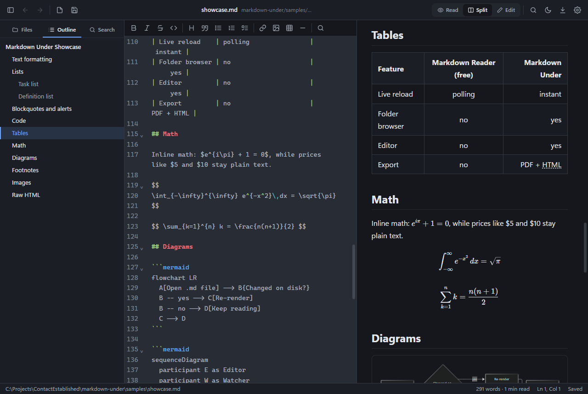

<h1 align="center">
  
</h1>

<p align="center">
  
</p>

A local, private Markdown reader **and** editor for Windows, built with Tauri 2.
It started as a personal replacement for the free tier of the
[Markdown Reader](https://md-reader.github.io/) browser extension, and adds the things
that extension doesn't do: folders, search, editing and export.

Nothing leaves your machine. There are no accounts, no telemetry and no network calls,
except for remote images that your documents link to.

## Features

| | Markdown Reader (free) | Markdown Under |
|---|---|---|
| Render `.md` / `.markdown` / `.mdx` | ✅ | ✅ |
| GFM tables, task lists, footnotes, emoji | ✅ | ✅ |
| KaTeX math, Mermaid diagrams | ✅ | ✅ |
| Syntax highlighting | ✅ | ✅ (Shiki, 200+ languages, loaded on demand) |
| GitHub alerts (`> [!NOTE]`) | ✅ | ✅ |
| Light / dark / custom CSS themes | ✅ | ✅ (themes folder) |
| Table of contents sidebar | ✅ | ✅ with scroll-spy, plus inline `[[_TOC_]]` |
| Live reload | polling interval | instant (OS file watcher), keeps scroll position |
| Folder browser + relative link navigation | — | ✅ with Back/Forward history |
| Full-text search across a folder | — | ✅ |
| Find in document | — | ✅ |
| Split-pane editor (source left, preview right) | — | ✅ with synced scrolling |
| Click task checkboxes to update the file | — | ✅ |
| Export to PDF and standalone HTML | — | ✅ |
| YAML front matter display | — | ✅ |
| Opens `.md` files from Explorer / command line | — | ✅ |
| Unsaved-change and external-change protection | — | ✅ |

Also supported: `==highlight==`, `++insert++`, `H~2~O`, `x^2^`, abbreviations,
definition lists, raw HTML (sanitized), copy buttons on code blocks.

## Keyboard shortcuts

| Action | Shortcut |
|---|---|
| Open file / folder | `Ctrl+O` / `Ctrl+Shift+O` |
| New file | `Ctrl+N` |
| Save / Save as | `Ctrl+S` / `Ctrl+Shift+S` |
| Read / Split / Edit mode | `Ctrl+1` / `Ctrl+2` / `Ctrl+3` |
| Toggle read ↔ split | `Ctrl+E` |
| Find in document | `Ctrl+F` (in the editor: find & replace) |
| Search folder | `Ctrl+Shift+F` |
| Toggle sidebar | `Ctrl+\` |
| Back / Forward | `Alt+←` / `Alt+→` (or mouse side buttons) |
| Zoom text | `Ctrl+=` / `Ctrl+-` / `Ctrl+0` |
| Print / Save as PDF | `Ctrl+P` |
| Export HTML | `Ctrl+Shift+E` |
| Toggle light/dark | `Ctrl+Shift+L` |
| Reload from disk | `F5` / `Ctrl+R` |
| Settings | `Ctrl+,` |
| Editor: bold / italic / link / code / strike | `Ctrl+B` / `Ctrl+I` / `Ctrl+K` / ``Ctrl+` `` / `Ctrl+Shift+X` |

## Custom themes

Open **Settings → Themes folder**. Every `.css` file there shows up under
**Custom theme** and is layered over the built-in light/dark styles. An `example.css`
is created for you. Scope rules to `.markdown-body` to style only the document.

## Chrome extension

`extension/` is a lighter, read-only companion that renders Markdown right in the browser.
It shares the desktop app's rendering code, so documents look the same in both.

- Renders `.md`, `.markdown`, `.mdx` and similar files opened from your computer (`file:///…`),
  and plain-text `.md` files on websites such as `raw.githubusercontent.com`.
- Same rendering as the desktop app: tables, task lists, footnotes, alerts, emoji, KaTeX math,
  Mermaid diagrams, Shiki code highlighting, front matter and `[[_TOC_]]`.
- Outline sidebar that follows your scroll, links between files, and `#heading` links.
- Live reload: local files re-render about a second after they change on disk.
- Toolbar (top right) to toggle the outline, switch theme, view the raw source and print / save as PDF.
- The toolbar icon opens settings: theme, font, text size, page width, outline, live reload,
  and whether to render `.md` files on websites.

The extension can't edit or save files, browse folders, or search across files; use the desktop app for those.

### Installing it

1. `npm run ext:build`. The extension is built into `extension/dist`.
2. Open `chrome://extensions`, turn on **Developer mode**, click **Load unpacked** and pick `extension/dist`.
3. Under the extension's **Details**, turn on **Allow access to file URLs** so it can render files on your computer.

After changing the code, run `npm run ext:build` again (or keep `npm run ext:watch` running)
and click the reload icon on the extension's card.

## Development

Prerequisites: Node 20+, Rust (stable), and WebView2 (preinstalled on Windows 11).

```powershell
npm install
npm run tauri dev      # desktop app with hot reload
npm run dev            # UI only, in a browser, on an in-memory demo folder (http://localhost:1420)
npm test               # frontend unit tests (vitest)
cd src-tauri; cargo test   # backend unit tests
npm run tauri build    # release build + installers in src-tauri/target/release/bundle
npm run ext:build      # Chrome extension into extension/dist
```

The browser mode (`npm run dev`) uses a fake in-memory file system with a few demo
documents, which makes UI work fast. Open `http://localhost:1420/?open=/demo/showcase.md`
to jump straight to the feature showcase. [`samples/showcase.md`](samples/showcase.md)
exercises every supported syntax feature.

### Layout

```
src/
  app.ts               App controller: documents, folders, modes, saving, watching, shortcuts
  backend/             Host abstraction: tauri.ts (desktop) and browser.ts (in-memory demo)
  render/              markdown-it pipeline, KaTeX plugin, Shiki highlighting, Mermaid, sanitizer
  ui/                  Preview, editor (CodeMirror 6), sidebar, find bar, settings, export
  lib/                 Path and text helpers (unit tested)
  styles/              tokens.css (theme colors), markdown.css (document), app.css (chrome)
extension/
  public/manifest.json Manifest V3; loader.js is the content script that hands the page to the viewer
  src/viewer.ts        In-page viewer built on the shared render/ and ui/preview.ts code
  src/background.ts    Re-reads local files for live reload (pages can't read file:// themselves)
  src/options.ts       Settings popup (chrome.storage.sync)
src-tauri/src/
  lib.rs               Tauri commands and app setup (single instance, plugins)
  fs_ops.rs            Read/atomic write, Markdown tree, folder search
  watcher.rs           File/folder watching (notify) → "fs-change" events
  themes.rs            Custom theme folder
```

### Security notes

Documents can contain raw HTML, so rendered output is sanitized with DOMPurify before it
reaches the page (scripts, iframes, forms, `<style>` and `<link>` are removed), Mermaid
runs in `strict` mode, and the app ships with a restrictive Content Security Policy.
Local images load through Tauri's asset protocol.
