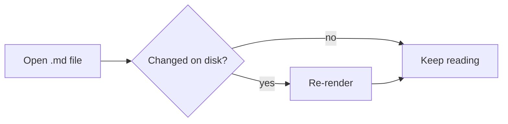
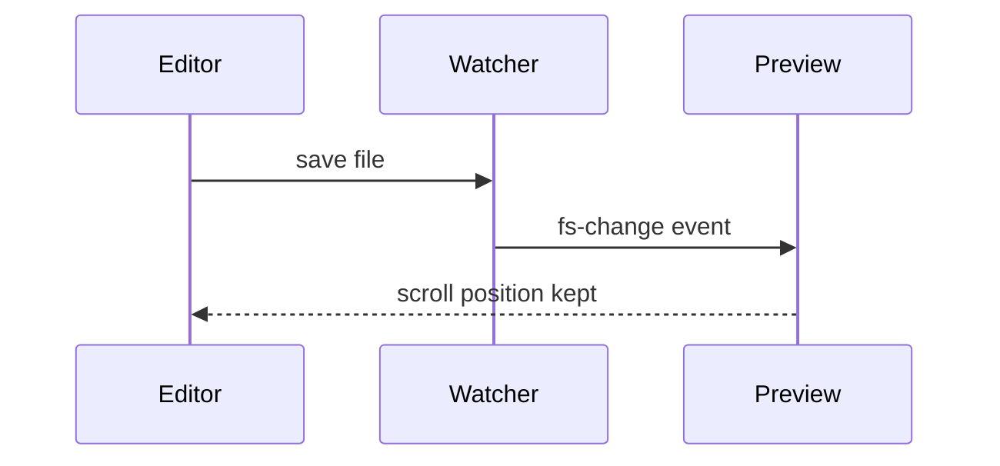

# Markdown Under Showcase

Everything Markdown Under renders, in one file. Open it in **Split** mode (Ctrl+E) to see the source next to the preview.

[[_TOC_]]

## Text formatting

Plain, **bold**, *italic*, ***both***, ~~strikethrough~~, `inline code`, ==highlighted==, ++inserted++, H~2~O, and E = mc^2^.

Typographic niceties: "smart quotes", -- en dash, --- em dash, and ellipsis...

Emoji shortcodes: :rocket: :tada: :white_check_mark: :warning:

Autolinked URL: https://example.com, and a [regular link](https://example.com "with a title").

*[HTML]: HyperText Markup Language
Abbreviations show a tooltip: HTML.

## Lists

1. First item
2. Second item
   - Nested bullet
   - Another one
     1. Deeper still
3. Third item

### Task list

Click a checkbox in the preview to toggle it in the file.

- [x] Render Markdown
- [x] Live reload
- [ ] Take over the world

### Definition list

Markdown Under
: A local Markdown reader and editor.

Tauri
: A toolkit for small, fast desktop apps with a web front end.

## Blockquotes and alerts

> A plain blockquote.
>
> > Nested inside another.

> [!NOTE]
> Useful information users should know.

> [!TIP]
> Helpful advice for doing things better.

> [!IMPORTANT]
> Key information users need to know.

> [!WARNING]
> Urgent info that needs immediate attention.

> [!CAUTION]
> Advises about risks or negative outcomes.

## Code

```typescript
interface Doc {
  path: string;
  dirty: boolean;
}

export function save(doc: Doc): Promise<void> {
  return backend.writeText(doc.path, editor.value);
}
```

```rust
fn main() {
    let greeting = "Hello from Rust";
    println!("{greeting}");
}
```

```python
def fib(n: int) -> int:
    return n if n < 2 else fib(n - 1) + fib(n - 2)
```

```bash
npm run tauri dev
```

```
A fence with no language stays plain.
```

## Tables

| Feature        | Markdown Reader (free) | Markdown Under |
| :------------- | :--------------------: | -------------: |
| Live reload    | polling                |        instant |
| Folder browser | no                     |            yes |
| Editor         | no                     |            yes |
| Export         | no                     |     PDF + HTML |

## Math

Inline math: $e^{i\pi} + 1 = 0$, while prices like $5 and $10 stay plain text.

$$
\int_{-\infty}^{\infty} e^{-x^2}\,dx = \sqrt{\pi}
$$

$$ \sum_{k=1}^{n} k = \frac{n(n+1)}{2} $$

## Diagrams





## Footnotes

Markdown Under renders footnotes[^1] with back-links[^note].

[^1]: Like this one.
[^note]: Footnotes can have any label.

## Images


## Raw HTML

<details>
<summary>Click to expand</summary>

HTML blocks work, and are sanitized before display.

</details>

<kbd>Ctrl</kbd> + <kbd>S</kbd> saves.

---

The end. [Back to top](#markdown-under-showcase)
