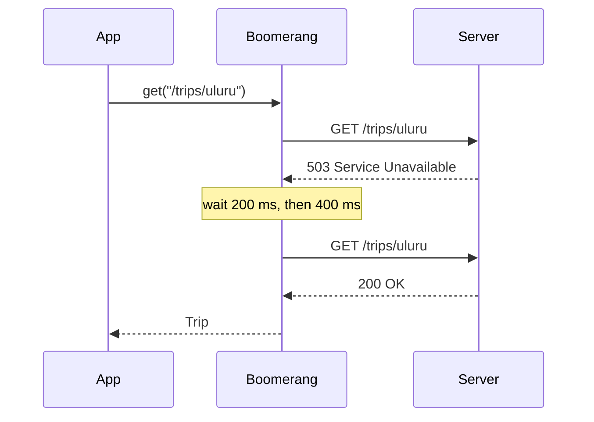

# Boomerang API

A tiny HTTP client that **always comes back**: automatic retries, timeouts and
typed responses for TypeScript.

> [!IMPORTANT]
> Version 2 requires Node 20 or later. See the migration guide before upgrading.

## Install

```bash
npm install boomerang-api
```

## Quick start

```typescript
import { createClient } from "boomerang-api";

const api = createClient({
  baseUrl: "https://api.example.com",
  retries: 3,          // try again on network errors and 5xx
  timeoutMs: 10_000,
});

interface Trip {
  id: string;
  destination: string;
  days: number;
}

const trip = await api.get<Trip>("/trips/uluru");
console.log(`${trip.destination}: ${trip.days} days`);
```

## How retries work



## Options

| Option | Type | Default | Description |
|--------|------|---------|-------------|
| `baseUrl` | `string` | — | Prepended to every request path |
| `retries` | `number` | `2` | Attempts after the first failure |
| `timeoutMs` | `number` | `30000` | Abort a request after this long |
| `headers` | `Record<string, string>` | `{}` | Sent with every request |

> [!CAUTION]
> Retries are only safe for idempotent requests. `post()` does not retry
> unless you pass `{ retry: true }`.

## Configuration file

```json
{
  "baseUrl": "https://api.example.com",
  "retries": 3,
  "headers": { "x-client": "boomerang/2.0" }
}
```
